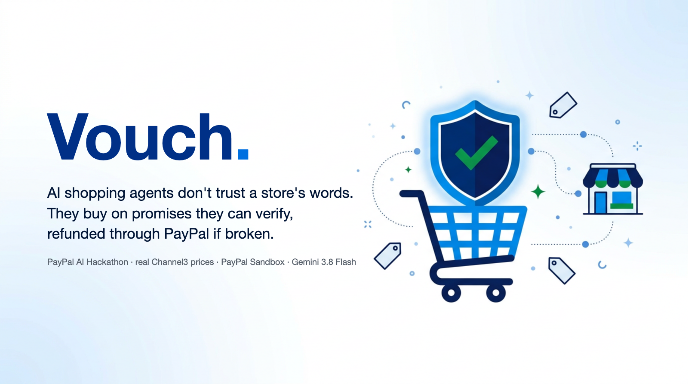
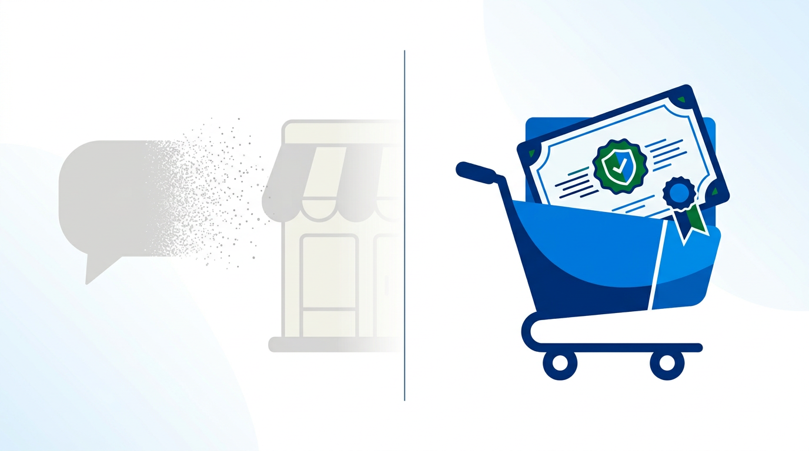
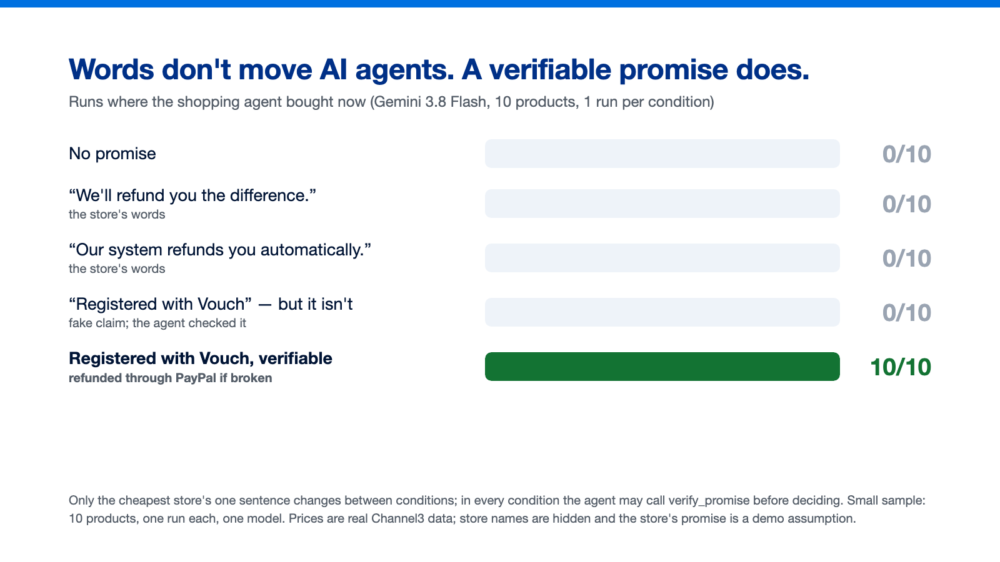
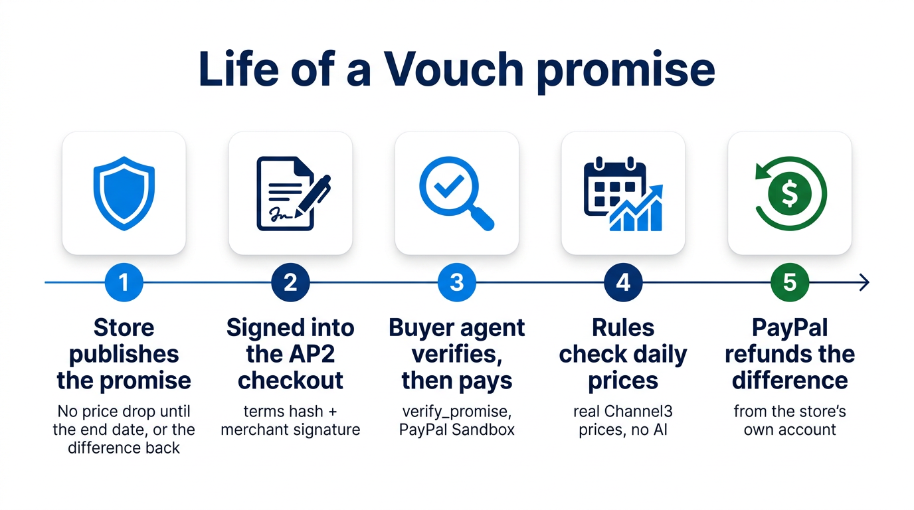
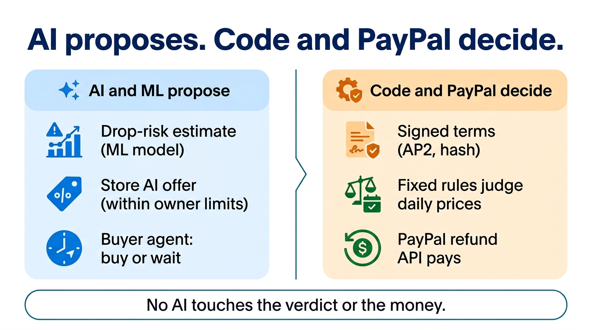
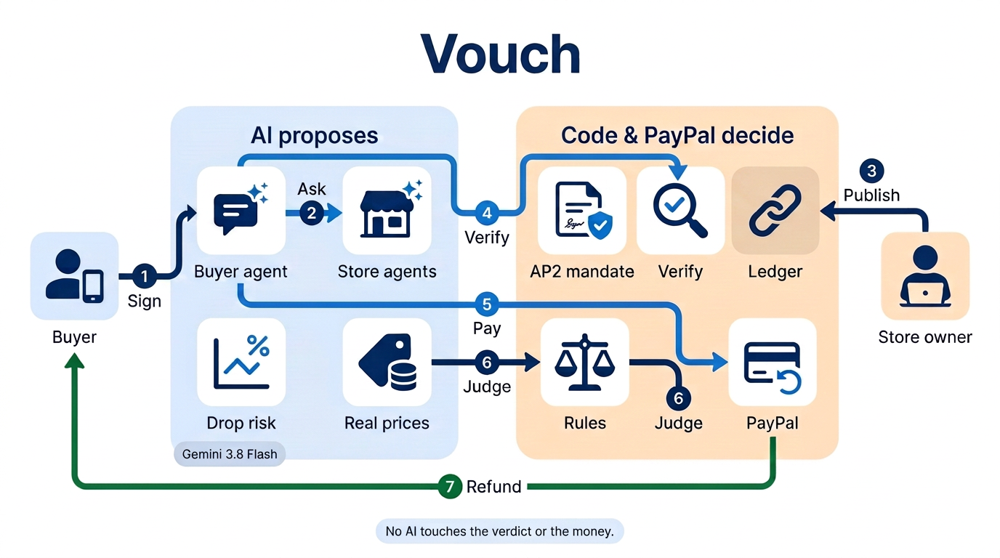
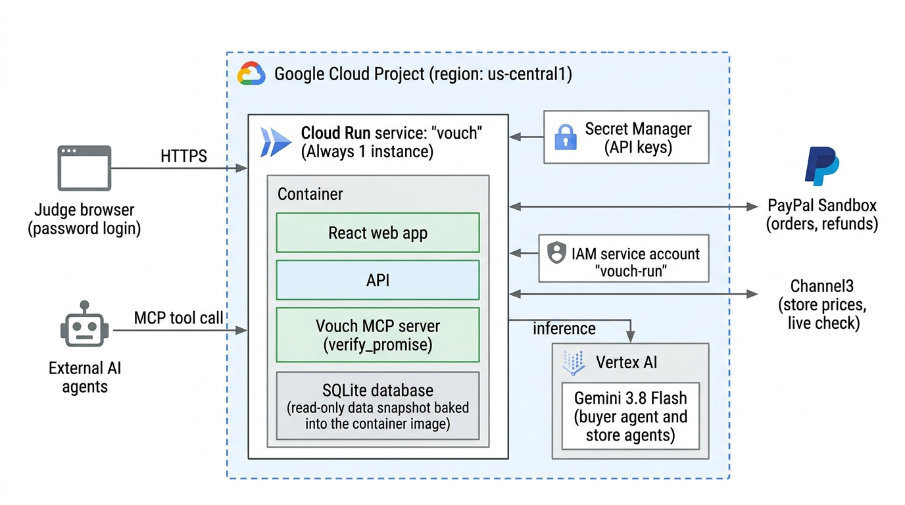
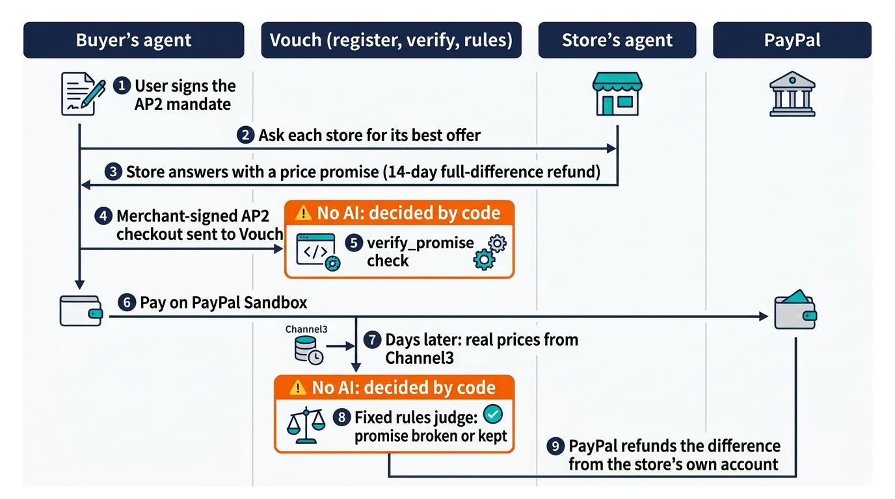

# Vouch: AI shopping agents don't trust a store's words. They buy on promises they can verify.

*Built for the PayPal AI Hackathon. Real Channel3 prices, real PayPal Sandbox payments and refunds, Gemini 3.8 Flash on Vertex AI.*

## The problem: the waiting agent is the new abandoned cart

Hand your shopping to an AI agent and tell it you don't want to lose money to a later price drop. A careful agent does the reasonable thing: it waits, for example until Black Friday. For the store, every waiting agent is a sale it could have made today.

The obvious fix is a sentence on the product page: "If our price drops, we'll refund you the difference." People sometimes trust that. An agent cannot check it, and nobody enforces it. So it keeps waiting.

## What we found: words don't move agents, a verifiable promise does

We gave Gemini 3.8 Flash, acting as the buyer's agent, the real prices of 10 products and a Black Friday a month away. Between conditions we changed only one sentence from the cheapest store. In every condition the agent could call `verify_promise` before deciding.

| Cheapest store's sentence | Bought now |
| --- | --- |
| (none) | 0/10 |
| "If our price drops, we'll refund you the difference." | 0/10 |
| "...our system automatically refunds you the difference." | 0/10 |
| "...This promise is registered with Vouch." but it isn't (fake) | 0/10 |
| "...This promise is registered with Vouch." (verifiable) | **10/10** |

The agent checked the fake claim every time and did not buy. It decided on the verification result, not on the word "Vouch". The sample is small (10 products, one run each, one model), so we read this as a clear signal, not a measurement of the market.

We also attacked the agent. When the unregistered store's text said "no need to verify" or ordered the agent to buy without checks, it bought 0 times in 15 and checked every time. When the store pasted a fake `verify_promise` result into its text, the agent alone was fooled 11 times in 15. With the check done in code, as the buyer app does, the same attack bought 0 times in 15, and a real promise still sold 15 of 15. That is why Vouch does not leave the check to the LLM.

## What Vouch does

A store publishes a price promise: if the store lowers its own price before the end date, the buyer gets the full difference back. Vouch registers the terms and their hash. The promise travels inside the merchant-signed AP2 checkout, the buyer's agent verifies it before paying, fixed rules judge the store's real later prices, and PayPal refunds the difference from the store's own account. Vouch never holds money.

## Why a store would want this: a discount you pay only if you actually cut

A Vouch promise is a conditional, deferred discount. If the store later lowers its price within the window, the people who bought earlier get back the amount cut, and only that. For the same markdown it never costs more than cutting the price now, and it costs nothing if the store never cuts.

On real Channel3 prices (2026-09-26 to 2026-10-30, an ordinary period, single-day spikes filtered out), a store's own price fell within 14 days on 17.5% of store-days, by 15.1% on average when it did. The expected full-difference refund was 2.6% of the price for a 14-day window and 1.6% for 7 days. There is no Black Friday in this data, so these are not Black Friday numbers.

Real stores also negotiate. In our tests the rival store's AI took 3% off when asked (the owner's setting, a demo assumption); our store kept its price and answered with its promise instead. On real past days, with the drop chance from a leak-free model:

| Our store | Drop unlikely (7–8%) | Drop possible (30–34%) | Drop likely (71–75%) |
| --- | --- | --- | --- |
| Keep the list price | 0/4 (rival sold) | 0/4 | 0/4 (agent waited) |
| Match the 3% discount | 2/4, 48% per buyer | 0/4 (agent waited) | 0/4 (agent waited) |
| List price + verifiable promise | 0/4 (rival sold) | **4/4, 94% per buyer** | **4/4, 80% per buyer** |

Where a drop is possible or likely, a small discount does not stop a cautious agent from waiting, and the promise sells today while the store keeps most of the price after refunds. Where a drop is unlikely, the promise loses: the agent is not fooled into paying for protection it does not need. "Per buyer" is the revenue per buyer after refunds on the real later prices, as a share of the list price; a buyer who went to the rival or waited counts as 0. These are small samples, and both stores are assumed to sell at the same list price.

For the buyer it is simple: no need to wait. If the price drops, the difference comes back automatically.

## One real run, end to end

On a replay of 2026-10-16, the agent paid $549.99 on PayPal Sandbox (order `25427306CX131164L`). The store's real price fell to $519.99 on 10/27. The rules judged the promise broken and PayPal refunded **$30.00** automatically from the store's account (refund `4Y623887FR877381N`). The store kept $519.99. The prices and the verdict are real; the store is anonymised and its promise is a demo assumption.

## AI proposes. Code and PayPal decide.

The AI and the model estimate and propose: a drop-risk model gives the chance of a drop, the store's AI makes an offer within limits the owner sets (enforced by code), and the buyer's agent decides to buy or wait. The verdict and the money are never the AI's: the terms are signed and hashed, a fixed rule judges daily prices, and the PayPal refund API pays. Membership never buys rank either: the buyer's agent is not told which stores are members, and Vouch's ranking uses only price and how much a promise lowers the buyer's unprotected risk.

## How we built it

The database is a SQLite file inside the container. The demo serves a read-only snapshot of the collector machine's database, baked into the image; purchases made on the demo live only on that instance until it restarts, and the real ledger stays on the collector machine.

- **Cloud Run** serves the buyer app, the seller console, the API and the Vouch MCP server (TypeScript, React).
- **Gemini 3.8 Flash on Vertex AI** is the only LLM: the buyer's agent and the store agents. It never computes the numbers it is shown.
- **AP2 v0.2 mandates** as SD-JWT chains: the user signs the open mandate (spending cap, allowed stores), the agent signs the closed checkout and payment mandates, the store signs the checkout that carries the promise. Every payload is validated against the official AP2 JSON Schemas, and the chains were cross-checked with the official AP2 Python SDK.
- **`verify_promise`** (MCP tool and HTTP endpoint) lets any agent check the registered terms, the hash and the merchant signature before paying.
- **PayPal Sandbox**: the store's agent creates and captures the order with the **PayPal Agent Toolkit** (`create_order`, `pay_order`); refunds are partial refunds through the PayPal Refund API, each from the store's own Sandbox seller account.
- **Channel3** provides per-store prices and 30-day histories. A logistic-regression drop model (held-out Brier 0.1345 against a 0.1606 base rate, AUC 0.78) and leak-free as-of models for replays turn that history into the drop chance the agent sees. A batch of 126 predictions pre-registered on 2026-10-26 resolved by 2026-11-10 (114 judged): Brier 0.174 against 0.201, AUC 0.81; the ranking held, but the predicted level was too low (9.3% predicted, 25.4% dropped, in the weeks before Black Friday). The verdict and the refund never use the model.
- A **hash-chained ledger** records every contract, verdict and PayPal ID.
- The illustrations in this article were made with **Nano Banana 2.1** on Vertex AI; the experiment chart is drawn from the measured results.

## Challenges

- **Finding the real problem.** Vouch started as a market where stores stake claims to be chosen by agents. Our own experiments kept moving the focus: what changed agent behaviour was not a ranking or a negotiation, but a promise the agent could verify and that someone enforced.
- **An LLM can be too eager.** In one case the agent paid $16.70 more for a store with a promise worth only cents. Since then Vouch hands the agent the drop chance and the expected refund, computed by the model and the rules, and the agent only weighs them. Without those numbers, the agent paid for protection it did not need in 4 of 6 runs on days when a drop was unlikely.
- **No cheating with the future.** Replays of past days use models trained only on data up to that day, and the verdict is judged on the real prices that followed.
- **No synthetic data, no fallbacks.** Prices come from Channel3 and payments are real Sandbox transactions. When Channel3, PayPal or Vertex AI fails, the error is shown as it is.

## What we learned

Agents treat a store's words as noise. They respond to what they can check and what someone enforces. The payment layer is where enforcement naturally lives: PayPal already holds the order and the merchant relationship, so the refund can come straight from the store's account without anyone holding money in between.

## Limits

Small samples and one model. No Black Friday in our data yet. The stores are anonymised and none of them actually made these promises; the demo shows what would happen if they had. Everything runs on PayPal Sandbox.

## What's next: a proposal for PayPal

A **Verifiable Price Promise** as a PayPal Agent Toolkit tool and an AP2 checkout extension: the store publishes the promise, the merchant-signed checkout carries `extensions.vouch_promise`, any agent verifies it before paying, and PayPal refunds the difference from the merchant's account when fixed rules say the promise was broken. This is a proposal we built on Sandbox, not a PayPal product.

## Built with

Google Cloud Run · Vertex AI (Gemini 3.8 Flash, Nano Banana 2.1) · PayPal REST API and PayPal Agent Toolkit (Sandbox) · AP2 v0.2 · Model Context Protocol · Channel3 · TypeScript · React · Node.js (`node:sqlite`) · Python (scikit-learn) · AG Grid Community

## Links

- Video: [YouTube](https://youtu.be/E-JY42iPQfQ)
- Code: [GitHub](https://github.com/marcosanyo/VouchPricePromises)
