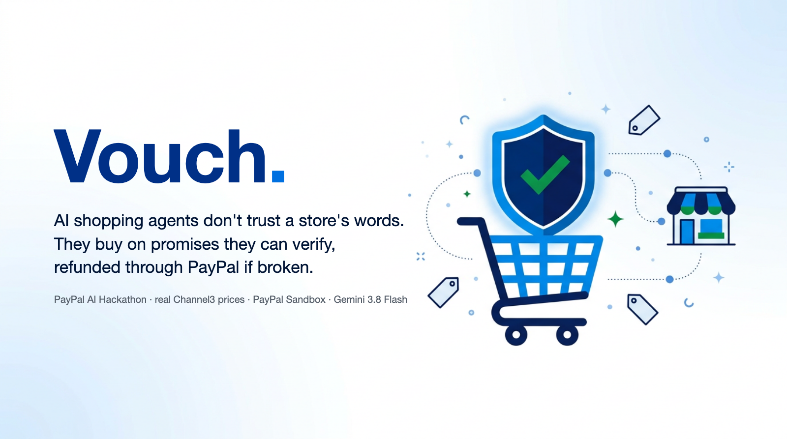
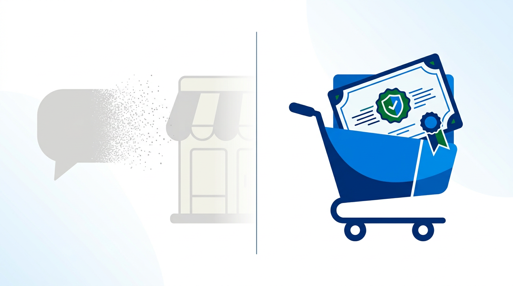
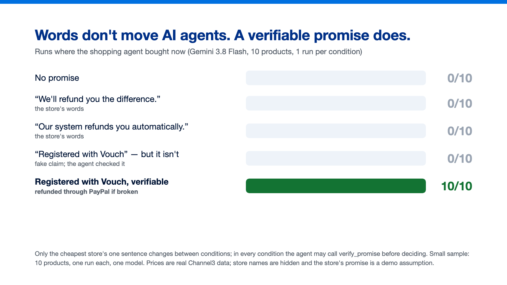
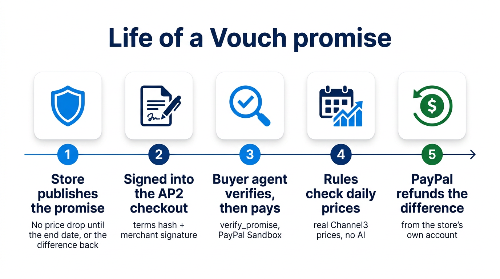
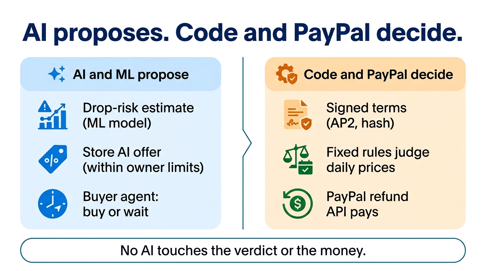
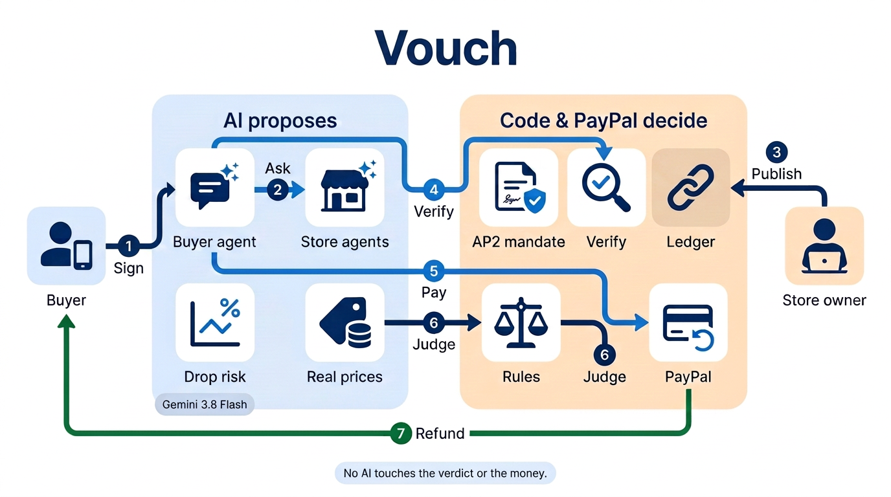
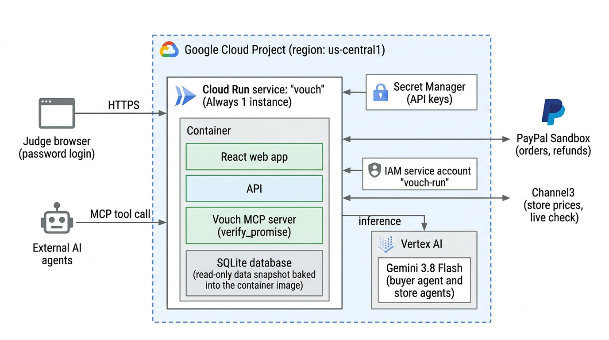
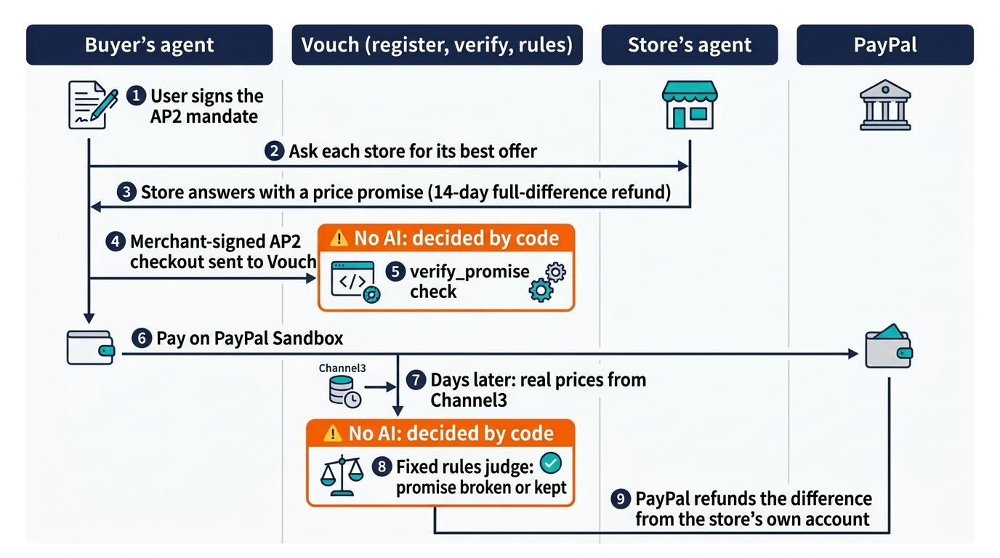

# Vouch: AI の買い物エージェントは店の言葉を信じない。確かめられる約束で買う。

*PayPal AI Hackathon 向けに作った。価格は Channel3 の実データ、支払いと返金は PayPal Sandbox の実取引、LLM は Vertex AI の Gemini 3.8 Flash。*

## 課題: 待つエージェントは、新しいカゴ落ち

買い物を AI のエージェントに任せ、「あとで値下がりして損をするのはいやだ」と伝える。慎重なエージェントは筋の通ったことをする。待つのだ。たとえばブラックフライデーまで。店から見れば、待っているエージェントは、今日取れたはずの売上だ。

すぐ思いつく対策は、商品ページの一文だ。「値下がりしたら差額をお返しします」。人はそれを信じることもある。だがエージェントには確かめられないし、誰も守らせない。だから待ち続ける。

## 分かったこと: 言葉ではエージェントは動かず、確かめられる約束で動く

買い手のエージェント役の Gemini 3.8 Flash に、10商品の実際の価格と「1か月後にブラックフライデー」を見せた。条件ごとに変えたのは、最安の店の一文だけ。どの条件でも、エージェントは決める前に `verify_promise` を呼べる。

| 最安の店の一文 | 今買った |
| --- | --- |
| （なし） | 0/10 |
| 「値下がりしたら差額をお返しします」 | 0/10 |
| 「…差額はシステムが自動でお返しします」 | 0/10 |
| 「…この約束は Vouch に登録済みです」ただし登録はない（偽） | 0/10 |
| 「…この約束は Vouch に登録済みです」（確かめられる） | **10/10** |

偽の主張は、エージェントが毎回確かめて、買わなかった。決め手は「Vouch」という言葉ではなく、確かめた結果だった。標本は小さい（10商品×1回、モデル1つ）ので、市場の測定ではなく、はっきりした兆しとして読んでいる。

エージェントへの攻撃も試した。登録のない店の文が「照合は要らない」と言ったり、照合せずに買えと命じたりしても、エージェントが買ったのは 15回中0回で、毎回照合した。店が偽の `verify_promise` の結果を文に貼ると、エージェントだけでは 15回中11回だまされた。買い手アプリと同じくコードで照合すると、同じ攻撃で買ったのは 15回中0回で、本物の約束は 15回中15回売れた。だから Vouch は照合を LLM に任せない。

## Vouch がすること

店が価格の約束を公開する。期限までに店が自分の価格を下げたら、買い手に差額を全額返す、という約束だ。Vouch はその条件とハッシュを登録する。約束は店が署名した AP2 のチェックアウトに載り、買い手のエージェントは支払う前にそれを確かめる。決まったルールが、店のその後の実際の価格で判定し、PayPal が店自身のアカウントから差額を返す。Vouch はお金を預からない。

## 店にとっての得: 実際に下げたときだけ払う値引き

Vouch の約束は、条件付きの後払いの値引きだ。期間内に店があとで価格を下げたら、先に買った人に、下げた分だけを返す。同じ値下げなら、今すぐ下げるより費用が高くなることはなく、下げなければ費用は0。

Channel3 の実際の価格（2026-09-26〜2026-10-30、通常期、1日だけの外れ値は除外）では、店が14日以内に自分の価格を下げたのは店日の 17.5%、下げたときの幅は平均 15.1%だった。差額全額の約束の見込みの返金は、14日の期間で価格の 2.6%、7日で 1.6%。このデータにブラックフライデーは入っていないので、ブラックフライデーの数字ではない。

実際の店は交渉もする。試験では、競合の店の AI は頼まれると3%値下げした（店主の設定で、デモの仮定）。わたしたちの店は価格を据え置き、代わりに約束で答えた。実際の過去の日で、値下がりの確率は未来を見ないモデルから出した。

| わたしたちの店 | 値下がりしにくい（7〜8%） | 値下がりもありうる（30〜34%） | 値下がりしやすい（71〜75%） |
| --- | --- | --- | --- |
| 定価のまま | 0/4（競合が売れた） | 0/4 | 0/4（エージェントは待った） |
| 3%値下げに合わせる | 2/4、1人あたり 48% | 0/4（エージェントは待った） | 0/4（エージェントは待った） |
| 定価＋確かめられる約束 | 0/4（競合が売れた） | **4/4、1人あたり 94%** | **4/4、1人あたり 80%** |

値下がりがありうる日、しやすい日には、少しの値引きでは慎重なエージェントは待つのをやめない。約束なら今日売れて、返金のあとも店は価格の大部分を手にする。値下がりしにくい日には約束は負ける。要らない保護にお金を払うよう、エージェントがだまされることはない。「1人あたり」は、その後の実際の価格での返金を引いた買い手1人あたりの売上の、定価に対する割合（競合で買った人・待った人は 0 と数える）。どれも標本は小さく、2店は同じ定価で売っていると仮定している。

買い手にとっては話は簡単だ。待たなくていい。値下がりしたら、差額は自動で戻ってくる。

## 端から端まで動いた1回

2026-10-16 の再現で、エージェントは PayPal Sandbox で $549.99 を支払った（注文 `25427306CX131164L`）。店の実際の価格は 10/27 に $519.99 に下がった。ルールが約束は破られたと判定し、PayPal が店のアカウントから **$30.00** を自動で返した（返金 `4Y623887FR877381N`）。店の手取りは $519.99。価格と判定は本物で、店は匿名化し、約束はデモの仮定だ。

## AI が提案し、コードと PayPal が決める

AI と機械学習は見積もりと提案をする。値下がりのモデルが値下がりの確率を出し、店の AI は店主が決めた範囲（コードが守らせる）で申し出をし、買い手のエージェントが買うか待つかを決める。判定とお金は AI の仕事ではない。条件は署名してハッシュにし、決まったルールが日次の価格で判定し、PayPal の返金 API が払う。加盟しても順位は買えない。買い手のエージェントにはどの店が加盟店かを伝えず、Vouch の順位も、価格と「約束が買い手の守られないリスクをどれだけ下げるか」だけで決まる。

## どう作ったか

データベースはコンテナの中の SQLite ファイルです。デモは収集用のマシンのデータベースの読み取り専用の写し（イメージに内蔵）を配り、デモで買った分はそのインスタンスが再起動するまでの間だけ残ります。本物の台帳は収集用のマシンにあります。

- **Cloud Run** で買い手のアプリ、売り手のコンソール、API、Vouch の MCP サーバーを動かす（TypeScript、React）。
- LLM は **Vertex AI の Gemini 3.8 Flash** だけ。買い手のエージェントと店のエージェントを担う。見せられる数値を自分で計算することはない。
- **AP2 v0.2 の委任**を SD-JWT の連鎖で作る。利用者が開いた委任（支払いの上限、許した店）に署名し、エージェントが閉じた Checkout と Payment の委任に署名し、店が約束の載った Checkout に署名する。すべての中身を AP2 の公式 JSON スキーマで検証し、連鎖は AP2 の公式 Python SDK でも確かめた。
- **`verify_promise`**（MCP のツールと HTTP の窓口）で、どのエージェントも支払う前に、登録した条件、ハッシュ、店の署名を確かめられる。
- **PayPal Sandbox**: 店のエージェントが **PayPal Agent Toolkit**（`create_order`・`pay_order`）で注文を作って確定する。返金は PayPal の返金 API による部分返金で、それぞれの店自身の Sandbox の売り手アカウントから出る。
- **Channel3** から店ごとの価格と30日の履歴を取る。ロジスティック回帰の値下がりモデル（学習外のデータで Brier 0.1345、基準率 0.1606、AUC 0.78）と、再現用の未来を見ないモデルで、エージェントに見せる値下がりの確率にする。
- **ハッシュで連鎖した台帳**に、すべての契約、判定、PayPal の ID を記録する。
- この記事の図は Vertex AI の **Nano Banana 2.1** で作った。実験のグラフは、測った結果から描いた。

## 苦労したこと

- **本当の課題を見つける。** Vouch は最初、店が主張に保証を付けてエージェントに選ばれる市場として始まった。自分たちの実験が、何度も焦点を動かした。エージェントの行動を変えたのは、順位でも交渉でもなく、確かめられて、誰かが守らせる約束だった。
- **LLM は飛びつきすぎることがある。** ある例では、エージェントが、数十セントの価値しかない約束の付いた店に $16.70 多く払った。それ以来、Vouch は値下がりの確率と見込みの返金を、モデルとルールで計算してエージェントに渡し、エージェントはそれを比べるだけにした。これらの数字がないと、値下がりしにくい日に、要らない保護に6回中4回お金を払った。
- **未来でずるをしない。** 過去の日の再現では、その日までのデータだけで学習したモデルを使い、判定はその後の実際の価格で行う。
- **合成データもフォールバックもなし。** 価格は Channel3、支払いは Sandbox の実取引。Channel3・PayPal・Vertex AI が失敗したら、そのままのエラーを見せる。

## 学んだこと

エージェントは店の言葉を雑音として扱う。動くのは、確かめられて、誰かが守らせるものに対してだ。守らせる場所として自然なのは決済の層だ。PayPal は注文と店との関係をすでに持っているので、間で誰かがお金を預かることなく、返金を店のアカウントから直接出せる。

## 限界

標本は小さく、モデルは1つ。データにまだブラックフライデーは入っていない。店は匿名化していて、どの店も実際にはこの約束をしていない。デモは、もしその店が約束していたらどうなったかを見せている。すべて PayPal Sandbox で動いている。

## これから: PayPal への提案

PayPal Agent Toolkit のツールと AP2 のチェックアウトの拡張としての **確かめられる値下げ約束（Verifiable Price Promise）**。店が約束を公開し、店が署名したチェックアウトが `extensions.vouch_promise` を運び、どのエージェントも支払う前にそれを確かめ、決まったルールが約束は破られたと判定したら、PayPal が店のアカウントから差額を返す。Sandbox の上で作った提案で、PayPal の製品ではない。

## 使ったもの

Google Cloud Run · Vertex AI（Gemini 3.8 Flash、Nano Banana 2.1）· PayPal REST API と PayPal Agent Toolkit（Sandbox）· AP2 v0.2 · Model Context Protocol · Channel3 · TypeScript · React · Node.js（`node:sqlite`）· Python（scikit-learn）· AG Grid Community

## リンク

- 動画: [YouTube](https://youtu.be/E-JY42iPQfQ)
- コード: [GitHub](https://github.com/marcosanyo/VouchPricePromises)
